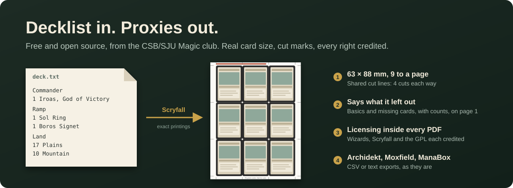

# CSB/SJU Magic: The Gathering

<p align="center">
  
</p>

<p align="center">
  <a href="TUTORIAL.md"><b>Tutorial: print a deck</b></a> ·
  <a href="decks/"><b>Club precons</b></a> ·
  <a href="https://archidekt.com/folders/1992238"><b>Staples</b></a> ·
  <a href="box/"><b>Deck box</b></a> ·
  <a href="proxier/"><b>Proxier reference</b></a>
</p>

Free, open tools from the CSB/SJU Magic club. The point is simple: **anyone should be able to sit down with a whole Commander deck and play it before buying a single card.** Print a deck, cut it, sleeve it in front of bulk cards, and play.

## What's here

| | |
|---|---|
| **[mtg-proxier](proxier/)** | Turns a decklist into a print-ready PDF of playtest cards: real card size (63 × 88 mm), 9 per page, with cut marks. Reads Archidekt, Moxfield and ManaBox exports, CSV or text, as they are. Card images come from [Scryfall](https://scryfall.com) at the exact printing you picked. |
| **[Club precons](decks/)** | Five Commander decks built for loaning to new players, ready to proxy. They're also kept on Archidekt in the [CSB/SJU Precon folder](https://archidekt.com/folders/1966850). |
| **[Staples](https://archidekt.com/folders/1992238)** | A hand-built reference of Commander staples, sorted by job: ramp, draw, interaction, tutors and more. |
| **[Deck box](box/)** | A 3D-printable two-piece clamshell for double-sleeved Commander decks. It's a friction fit, with no hinge, magnet or latch. STL files included. |

## Print a deck in five minutes

On Windows, after installing [Python](https://www.python.org/downloads/) (tick **Add python.exe to PATH**):

1. **Code → Download ZIP** on this page, and unzip it.
2. Open the `proxier` folder, right-click an empty spot, and choose **Open in Terminal**.
3. Run:
   ```
   .\proxy.bat ..\decks\precon-strength-in-numbers.txt --skip-basics
   ```
4. Open `decks\precon-strength-in-numbers.pdf` and print it at **100% / Actual size**, not "Fit to page".

The first run takes a few minutes: it sets itself up and downloads every image. The **[tutorial](TUTORIAL.md)** walks through every step and shows what you should see at each one. It also covers proxying your own deck, and what to do when something goes wrong.

## What the PDF tells you

- **What it left out.** With `--skip-basics`, page 1 lists the basic lands it didn't print, with counts (*Basic lands not included (27): 17 Plains, 10 Mountain*). Any card it couldn't find gets listed there too. Whoever gets the printout knows exactly what to add.
- **Whose is what.** Every PDF credits each owner in its document properties. The card images, names and text are © Wizards of the Coast. The images and data came from Scryfall. The software that made the file is GPL. Every page is footed *Playtest cards. Not for sale.* [Full details](proxier/README.md#whats-written-into-the-pdf).
- **Exact printings.** When the export carries Scryfall IDs, as Archidekt's CSV does, you get the art you picked, unaltered, with the artist credit intact.

## License: open, and it stays open

You're free to use, study, change, share, and sell anything here. The one condition is that anything you distribute that's built from it goes out under the same license, so nobody can take this and close it up.

| Part | License |
|---|---|
| `proxier/` (code) | [GPL-3.0-or-later](LICENSES/GPL-3.0-or-later.txt) |
| `box/` (3D models) and `decks/` (decklists) | [CC BY-SA 4.0](LICENSES/CC-BY-SA-4.0.txt): credit "chud", share alike |

The card art was never ours to license. The proxier downloads it from Scryfall when you run it, it stays © Wizards of the Coast, and none of it is stored in this repo.

## Layout

```
README.md          this page
TUTORIAL.md        step by step, for first-timers
llms.txt           test procedure for an AI assistant helping someone run the tool
proxier/           the tool: mtg_proxier.py, proxy.bat (Windows launcher), tests
decks/             the club precons (CSV and text, straight from Archidekt)
box/               deck box STL files
docs/              images for these pages
LICENSES/          full license texts
```

## Help and contributions

Something broke, or a deckbuilder's export doesn't read right? [Open an issue](https://github.com/bapbapbapbap/CSB-SJU-Magic-the-Gathering/issues) and attach the decklist. If you're asking an AI assistant for help, point it at [`llms.txt`](llms.txt): it has the whole test procedure and the expected output for every step.

---

<sub>Unofficial Fan Content permitted under the Wizards of the Coast <a href="https://company.wizards.com/en/legal/fancontentpolicy">Fan Content Policy</a>. Not approved or endorsed by Wizards. Portions of the materials used are property of Wizards of the Coast. ©Wizards of the Coast LLC. Not affiliated with Scryfall.</sub>
